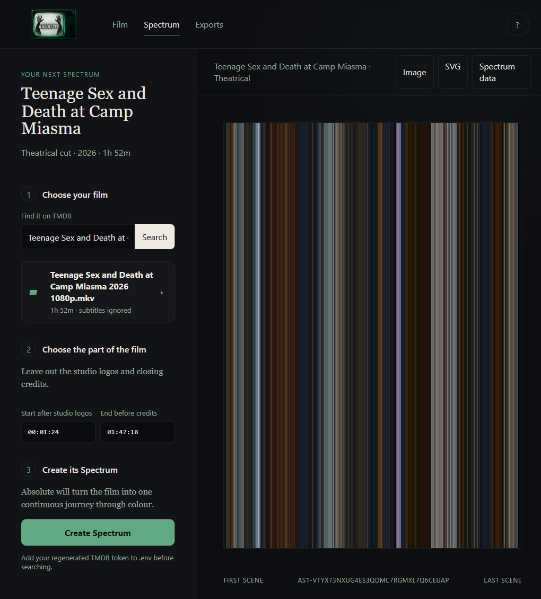

# Absolute

**The absolute app for absolute cinema.**

Absolute is a private, local-first film archive for discovering movies, recording what you watch, and preserving a film's visual journey as an **Absolute Spectrum**—a continuous colour signature sampled from the movie itself.



## What it does

- Search and browse films using TMDB metadata.
- Explore movie pages with backdrops, posters, complete cast and crew credits, and individual filmographies.
- Mark films as watched, keep a watchlist, rate and review films, log rewatches, and save private comments.
- Browse your archive by diary, watched films, watchlist, reviews, ratings, or generated spectra.
- Import watched films, diary dates, ratings, reviews, and watchlist entries from a Letterboxd data export.
- Generate a downloadable 2,048-sample colour spectrum from a local movie file.
- Suggest where studio logos end and closing credits begin while keeping the final cut points editable.

## Privacy

Absolute runs on `127.0.0.1` and stores its library in a local SQLite database. Movie files, the database, generated exports, Letterboxd data, and API credentials are excluded from Git.

The application contacts TMDB for film metadata and artwork. A Letterboxd import may use TMDB searches to match titles from the export.

## Requirements

- Python 3.10 or newer
- [FFmpeg](https://ffmpeg.org/) and `ffprobe` available on `PATH`
- A [TMDB API Read Access Token](https://www.themoviedb.org/settings/api)

Install the Python dependency with `python -m pip install -r requirements.txt` before starting the application. Email registration uses Argon2 password hashing.

## Setup

1. Clone the repository:

   ```powershell
   git clone https://github.com/Thatweirdguy1/absolute.git
   cd absolute
   ```

2. Create a local environment file:

   ```powershell
   Copy-Item .env.example .env
   ```

3. Add your TMDB Read Access Token to `.env`:

   ```text
   TMDB_READ_TOKEN=your_token_here
   ```

4. Start Absolute:

   ```powershell
   .\start-absolute.ps1
   ```

   Or run `python app.py` on any supported platform.

5. Open [http://127.0.0.1:8765](http://127.0.0.1:8765).

## Email registration (development)

The registration page is at `/register`. New accounts remain unverified until the user opens an emailed, one-hour, single-use verification link. Configure `ABSOLUTE_BASE_URL`, `SMTP_HOST`, `SMTP_PORT`, `SMTP_USER`, `SMTP_PASSWORD`, and `SMTP_FROM` in your ignored `.env`. The SMTP server must support implicit TLS. If mail is not configured, registration fails closed. Never commit SMTP credentials or use an HTTP base URL outside localhost.

Registration is an initial account-creation slice, **not a complete multi-user deployment**: sign-in, sessions, MFA, account-scoped library data, and authorization of existing endpoints are not implemented. Do not expose this development server to the internet.

## Importing from Letterboxd

Request your export from Letterboxd's **Settings → Import & Export**, then choose the ZIP from Absolute's library page. Preview it before importing: if a Letterboxd rating or review differs from an existing Absolute entry, choose which version to keep for that field. The local version is the default, and the preview makes no changes. Absolute checks each film link against Letterboxd's TMDB identity, saves confirmed matches for later imports, and lists uncertain or corrected links in the library's **Match audit**. Review uncertain matches there or choose the correct TMDB result. The report shows source, applied, and unmatched counts; a linked record is not necessarily a verified match.

The library also offers a complete ZIP backup and restore. Each import creates a local database snapshot first, and restoring a backup saves the current archive before replacing it. Backups and imported data stay under `data/` and are excluded from Git.

## Generating an Absolute Spectrum

Open **Create Spectrum**, choose a local movie file, confirm the suggested start and end points, and begin generation. Absolute reads frames through FFmpeg, samples and smooths their colours, and exports both SVG artwork and JSON spectrum data.

Generation can take time for long or high-resolution films. Keep the app running until the process completes.

## Security notes

- The server binds only to the local loopback address.
- Host and origin checks reject non-local browser requests.
- Only a movie selected through the local file picker can be processed.
- Upload size and JSON request limits are enforced.
- Secrets, personal databases, movie files, and generated artifacts are ignored by Git.

Do not expose the development server directly to the internet. Add authentication, HTTPS, production-grade request handling, and a deployment review before adapting Absolute for remote access.

## Verification

Run the built-in check with:

```powershell
python app.py --self-test
```

## Data and attribution

This product uses the TMDB API but is not endorsed or certified by TMDB. Letterboxd is a trademark of its respective owner; Absolute is not affiliated with or endorsed by Letterboxd.

